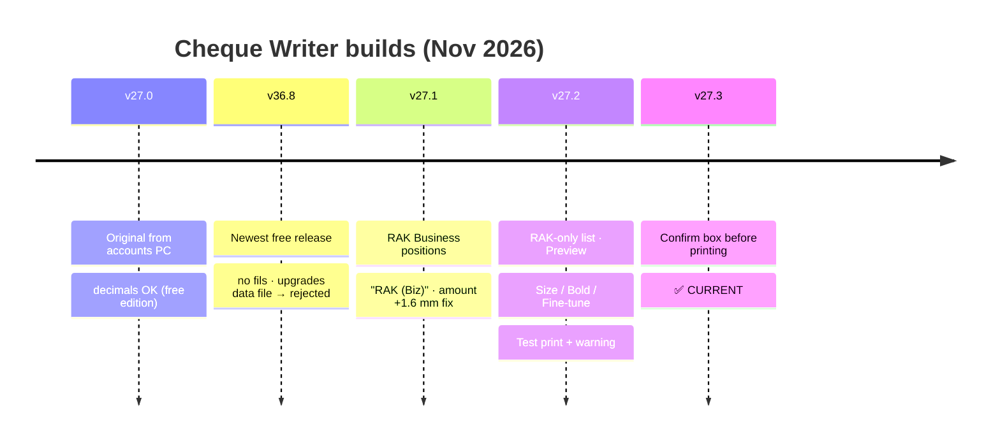
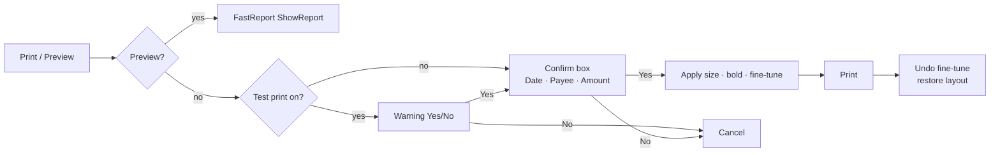

<div align="center">


</div>

---

> **What this repo is:** the documentation, installer and patch scripts for the company's
> **Chrysanth Cheque Writer 27.0** install. Its folders mirror the laptop folder
> `C:\Program Files (x86)\Chrysanth\Cheque Writer` one-to-one, **except the Chrysanth `.exe`/`.zip`
> files, which stay on the company PCs** (proprietary software, see [Licensing](#-licensing)).
> Each build folder has a `BUILD.md` with its SHA-256, so the laptop copies can be checked.
>
> Our own replacement app lives in [`Own App - ChequeWriter (.NET 8)/`](<Own App - ChequeWriter (.NET 8)/>).

## 📂 Folder map: laptop ↔ GitHub

| Laptop (`…\Chrysanth\Cheque Writer\`) | This repo |
|---|---|
| `CSCheckWriter.exe` + DLLs (installed v27.3) | not included (proprietary) |
| `README.txt` | [`README.txt`](README.txt) (same file) |
| `Builds\CURRENT - v27.3 (RAK only + options + confirm)\` | [`BUILD.md`](<Builds/CURRENT - v27.3 (RAK only + options + confirm)/BUILD.md>) |
| `Builds\OLD - v27.2 (RAK only + options)\` | [`BUILD.md`](<Builds/OLD - v27.2 (RAK only + options)/BUILD.md>) |
| `Builds\OLD - v27.1 (RAK Biz, all banks - undo copy)\` | [`BUILD.md`](<Builds/OLD - v27.1 (RAK Biz, all banks - undo copy)/BUILD.md>) |
| `Builds\OLD - v27.1 test builds\` | [`BUILD.md`](<Builds/OLD - v27.1 test builds/BUILD.md>) |
| `Builds\OLD - v27.0 (original, accounts PC)\` | [`BUILD.md`](<Builds/OLD - v27.0 (original, accounts PC)/BUILD.md>) |
| `Builds\OLD - v36.8 (free - DO NOT USE on accounts PC)\` | [`BUILD.md`](<Builds/OLD - v36.8 (free - DO NOT USE on accounts PC)/BUILD.md>) |
| `Builds\Tools\*.py` | [`Builds/Tools/`](Builds/Tools/) (same files) |
| `Share - Accounts PC\…update\` INSTALL / UNDO / READ ME | [`Share - Accounts PC/`](<Share - Accounts PC/>) (same files, no exe) |
| `Share - Accounts PC\…update.zip` | not included (contains the exe) |
| — | [`Own App - ChequeWriter (.NET 8)/`](<Own App - ChequeWriter (.NET 8)/>): our own app (source code) |

## 🧭 Version history



| Version | Status | Summary |
|:-:|:-:|---|
| **v27.3** | 🟢 **CURRENT** | v27.2 + **confirm box** (Date / Payee / Amount → *Print this cheque now?*) |
| v27.2 | ⚪ OLD | RAK-only bank list, Preview Cheque, Size / Bold, per-field fine-tune, Test print + warning, update check off |
| v27.1 | ⚪ OLD · undo copy | RAK (Biz) layout on RAK Business positions, fils, all banks |
| v27.0 | ⚪ OLD · original | Untouched Chrysanth 27.0.270.971 |
| v36.8 | 🔴 DO NOT USE | Free 36.8: whole numbers only, and upgrades `DB.CSDB` so v27 can't open it |

## ✨ What we did

<table>
<tr><td width="50%" valign="top">

**🏦 RAK-only bank list**
- 79 banks reduced to the 3 RAK layouts: **RAK (Biz)**, Rak Bank Amal, Rak Bank (Personal)
- the trailing **"More…"** item and its Outlook *"support my bank"* e-mail are removed
- banks are matched by ID, so no layout shifts

**👁 Preview Cheque**
- Print ▾ / Tools menu: the cheque on screen, using the same data path as printing
- replaces *Print Envelope*
- skips the after-print prompts

**✅ Confirm before printing** *(v27.3)*
- shows the **Date / Payee / Amount** exactly as entered
- **No** cancels, so no cheque is wasted

</td><td width="50%" valign="top">

**🔠 Font controls** (Options › Font)
- **Size** −2 … +3 and **Bold** for all printed text
- each field's original size is kept, so sizes never creep up print after print

**📐 Fine-tune position** (Options › Font)
- move **Date, Payee, Amount, Amount in words** separately
- 0.5 mm steps, ±4 mm (+ = right / down), undone after every print

**🧪 Test print** (Options › General)
- prints the **real cheque picture** under the text on plain A4
- a **warning** appears if you print with it ticked

**🛡 Safety**
- automatic update check off (protects the accounts PC from v36.8)

</td></tr>
</table>

## ⚙️ How it works / optimizations



- **No new runtime or DLLs.** Everything is done inside the existing program with small, targeted changes. The new code sits in its own PE section (`.cave`), so none of the original code is overwritten beyond short jumps.
- **Reuses the program's own routines** (FastReport `FindObject`/`ShowReport`, VCL `FindComponent`, the settings writer), so behaviour matches the original UI.
- **No data-file changes.** New settings reuse existing rows (the old envelope and RTL slots) with a validity marker, so the Firebird schema is untouched and v27 data stays compatible.
- **Idempotent printing.** Original font size and style are cached per object, and nudges are applied and then reverted around each job, so repeated prints are identical.
- **Every patch is checked.** Each script refuses to run if the bytes it expects aren't there, and each build has a SHA-256 in its `BUILD.md`.
- **Safe rollout.** `INSTALL.bat` checks the version, backs up the data and exe, verifies the copy byte for byte, and `UNDO.bat` reverts it.

## 🚀 Install on the accounts PC

1. Close Cheque Writer.
2. Copy **`Share - Accounts PC\Cheque Writer v27.3 - Accounts PC update.zip`** from the laptop, then right-click › **Extract All**.
3. Run **`INSTALL.bat`** and click **Yes** at the Windows prompt.
4. Open Options › General and make sure **Test print** is **unticked**.
5. Choose **RAK (Biz)**, click **Preview Cheque**, then print on plain paper and hold it over a real cheque.

Rollback: `UNDO.bat`.

## 🛠 Rebuild (Python 3 + `capstone`)

```bash
python "Builds/Tools/patch_v27.2_part1.py" <v27.1-rak-only.exe> step1.exe   # Preview + Size
python "Builds/Tools/patch_v27.2_part2.py" step1.exe            v27.2.exe   # Bold, fine-tune, warning
python "Builds/Tools/patch_v27.3.py"       v27.2.exe            v27.3.exe   # confirm box
python "Builds/Tools/read_bank_layouts.py" CSCheckWriter.exe frxrptRakBank  # list a layout's fields
```

<details>
<summary><b>Technical notes (offsets in the 27.0 exe)</b></summary>

- Bank list builder: jumps at file `0x3a3489→0x3a365b`, `0x3a36e1→0x3a4222`, `0x3a4265→0x3a4933`. "More…" `Items.Add` NOPed at `0x345627`, mailto handler skipped at `0x4ae2a8`.
- Test print flag = settings row `0x2723`, config `[[0x8e940c]]+0x54`, which sets `Picture1.Printable` (`TfrxView+0x10C`).
- Preview: the print dispatcher's `ecx` flag selects FastReport `ShowReport` instead of `Print`.
- Settings writer is UPDATE-only, so rows are reused: `0x2711` (old envelope) = size/bold/date+payee nudges, `0x2724` (old RTL) = amount+words nudges, bit 24 = valid marker.
- Font loop hook at `0x748850`, undo hook before `0x7486d4`, confirm/warning hook at `0x8ae55a`.

</details>

## ⚖ Licensing

- **Chrysanth Cheque Writer is proprietary software by Chrysanth.** None of its files are published here, and the patched builds are for internal use on the company's own PCs only.
- **Licensing and registration were not touched.** No licence, registration or payment check was cracked or bypassed.
- **Fils/decimals work because v27 Free has no whole-number limit.** That limit was only added in the v36.8 Free edition, and we kept the older version.
- **The added features are our own code** (Preview, Size/Bold, fine-tune, Test print, confirm box). They are not unlocked paid features.
- **The update check is turned off for safety**, so the accounts PC can't be moved to v36.8. Chrysanth's paid editions offer the same switch. If the company wants Chrysanth's supported features, it should buy the upgrade.
- **The long-term plan is our own app** in [`Own App - ChequeWriter (.NET 8)/`](<Own App - ChequeWriter (.NET 8)/>), which removes the dependency on patched third-party software.

<div align="center">

</div>
