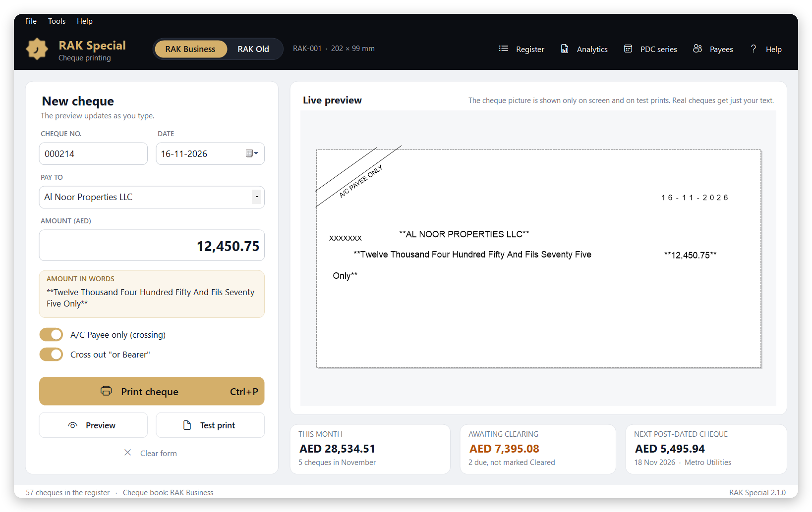
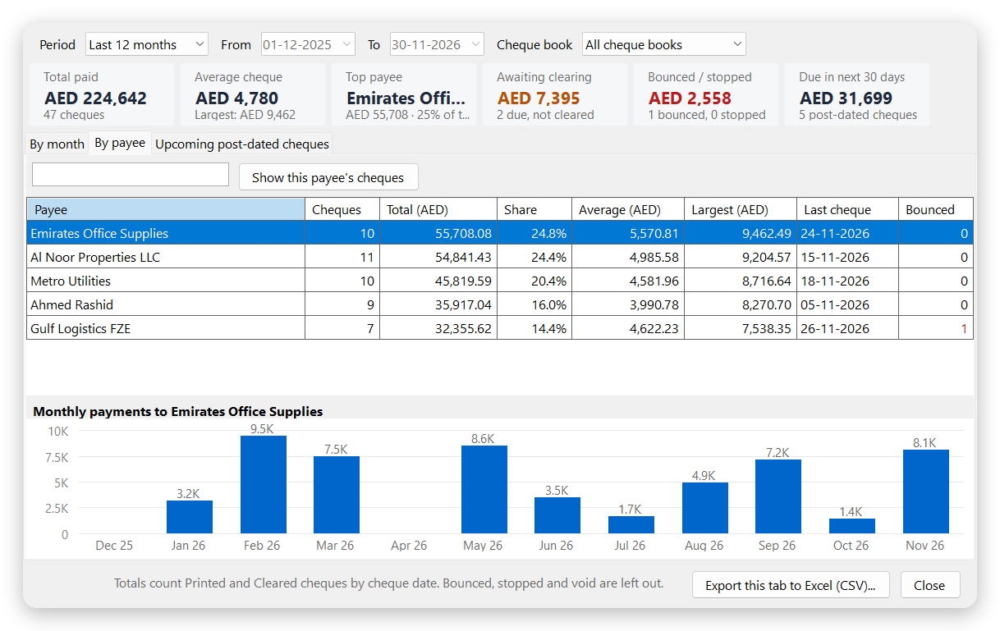
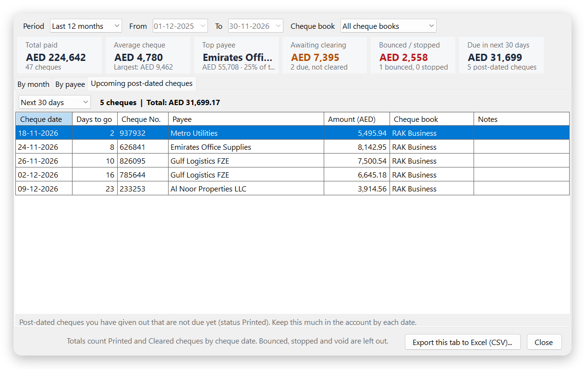

<div align="center">


# RAK Special: RAK Bank Cheque Printing Software for Windows

**Free cheque printing software for UAE businesses. Print RAKBANK cheques on any office printer.**

Prints the date, payee, amount in figures and the **amount in words in AED with fils**. It also prints
**post-dated cheque (PDC) series** for rent and instalments, keeps a **cheque register** and shows **spending analytics**.
It works offline, with no subscription.

<sub>برنامج مجاني لطباعة شيكات بنك رأس الخيمة الوطني (RAKBANK) على ويندوز · كتابة المبلغ بالكلمات بالدرهم والفلس · طباعة الشيكات المؤجلة</sub>

[](https://github.com/KarthickRaja46/RakSpecial/releases/latest)
[](https://github.com/KarthickRaja46/RakSpecial/releases)
[](https://github.com/KarthickRaja46/RakSpecial/actions/workflows/build.yml)


[**Download**](https://github.com/KarthickRaja46/RakSpecial/releases/latest) ·
[Features](#features) ·
[Install](#installation) ·
[Quick start](#quick-start) ·
[Support](#support)

<br>



</div>

---

## Contents

- [Why RAK Special](#why-rak-special)
- [Features](#features)
- [Screenshots](#screenshots)
- [Supported cheque books](#supported-cheque-books)
- [System requirements](#system-requirements)
- [Installation](#installation)
- [Quick start](#quick-start)
- [Keyboard shortcuts](#keyboard-shortcuts)
- [Your data, privacy and backups](#your-data-privacy-and-backups)
- [Troubleshooting](#troubleshooting)
- [Frequently asked questions](#frequently-asked-questions)
- [Support](#support)
- [Building from source](#building-from-source)
- [Contributing](#contributing)
- [Roadmap](#roadmap)
- [About](#about)

## Why RAK Special

UAE businesses write cheques every week for rent, suppliers, salaries and instalments. Writing them by hand is slow,
and a spelling mistake in the amount in words can get a cheque rejected. RAK Special types every cheque the same way:
correctly spelled, aligned to the real RAK Bank leaf, and recorded in a register you can search, analyse and export.

## Features

### Cheque printing
- **Both RAK Bank cheque books** (RAK Business and RAK Old), with layouts measured from real leaves.
- **Amount in words with fils**: `4523.20` prints as *Four Thousand Five Hundred Twenty Three And Fils Twenty Only*.
  Long amounts wrap onto the second line automatically, and you are warned if the words do not fit.
- **A/C Payee crossing** and **"or Bearer" strike-through**, each on or off per cheque.
- **Preview on a picture of the real cheque**, and **plain-paper test prints**, so you check alignment before
  using a real leaf.
- **Confirm before every print** (date, payee, amount and words) and a **duplicate cheque number** warning.

### Post-dated cheques (PDC)
- Enter the payee, amount, first cheque number and first date once, then print a whole series, e.g. 12 monthly rent cheques.
- Month ends stay correct (31 Jan → 28 Feb → 31 Mar). Dates that fall on a UAE weekend can move to Monday or to the
  Friday before.

### Cheque register and status
- Every printed cheque is recorded: search, date filter, notes, reprint, and **export to Excel**.
- Track each cheque as **Printed, Cleared, Bounced, Stopped or Void**. Several cheques can be marked at once while
  checking the bank statement, and a reason is saved for bounced and stopped cheques.

### Analytics
- **Summary cards**: total paid, average and largest cheque, top payee, cheques awaiting clearing,
  bounced or stopped cheques, and the amount due in the next 30 days.
- **By month**: a chart and a table with the change from the previous month. Future (post-dated) months are shown lighter.
- **By payee**: cheques, total, share, average, largest and bounces for every payee, with a monthly chart for each one.
- **Upcoming post-dated cheques**: what is due in the next 30, 90 or 365 days, so the money is in the account in time.
- Filter by period (this month, last 12 months, this year, custom dates) and by cheque book. Every table exports to Excel.

### Built for everyday office use
- **Modern, clean workspace**: the cheque form on the left, a live preview on the right, and this month's
  totals, cheques awaiting clearing and the next post-dated cheque always in view. Switch cheque books with one click.
- **Payee list** with auto-complete. New payees are saved automatically.
- **Layout editor**: drag any field, move it 0.1 mm at a time, change the font size or make it bold, and set a
  printer offset. You can also use your own scan of a blank cheque.
- **Built-in help and support**: email, WhatsApp, and a problem report that already includes the details support needs.
- **Automatic update check** with a one-click download of the new version.
- **Setup wizard** with Start-menu and Desktop shortcuts and a normal uninstaller. No administrator rights needed.

## Screenshots

<table>
  <tr>
    <td width="50%" valign="top">
      
      <p align="center"><b>Analytics by month</b><br><sub>Total paid, awaiting clearing, bounced cheques and a monthly chart</sub></p>
    </td>
    <td width="50%" valign="top">
      
      <p align="center"><b>Analytics by payee</b><br><sub>What each payee received, with a monthly chart</sub></p>
    </td>
  </tr>
  <tr>
    <td width="50%" valign="top">
      
      <p align="center"><b>Upcoming post-dated cheques</b><br><sub>Know how much must be in the account, and by when</sub></p>
    </td>
    <td width="50%" valign="top">
      
      <p align="center"><b>Help &amp; support</b><br><sub>Email, WhatsApp and problem reports, built in</sub></p>
    </td>
  </tr>
</table>

<sub>Screenshots use sample data. The preview shows the cheque outline; you can add your own scan of a blank cheque in the layout editor.</sub>

## Supported cheque books

| Cheque book | Code | Leaf size | How to tell them apart |
|---|---|---|---|
| RAK Business (new model) | RAK-001 | 202 × 99 mm | Amount box level with the **first** words line |
| RAK Old (wider book) | RAK-002 | 206 × 100 mm | Amount box lower, level with the **second** words line |

Choose the book in your hand. The wrong choice prints the figures in the wrong place.
Other banks can be added with the layout editor; see the [Roadmap](#roadmap).

## System requirements

| | |
|---|---|
| Operating system | Windows 10 or Windows 11, 64-bit |
| Printer | Any Windows printer that takes A4 paper (laser recommended) |
| Disk space | About 80 MB |
| Other software | None. .NET is built in. |
| Permissions | Normal user. No administrator rights needed. |
| Internet | Not needed. Used only for the optional update check and the support links. |

## Installation

1. Download **`RAKSpecial-Setup-<version>.exe`** from the
   [latest release](https://github.com/KarthickRaja46/RakSpecial/releases/latest).
2. Double-click it and follow the wizard: **Next → Install → Finish**.
   It adds *RAK Special* to the Start menu, and to the Desktop if you leave that box ticked.
3. The last page shows the first steps, then RAK Special opens.

> **"Windows protected your PC"?** Click **More info → Run anyway**. Windows shows this for new programs that are
> not code-signed yet. The setup file comes only from this repository's Releases page.

| | |
|---|---|
| **Update** | When a new version is out, RAK Special shows a yellow bar: click **Download the setup** and run it. Your data is kept, and a running RAK Special is closed for you first. |
| **Uninstall** | *Windows Settings → Apps → Installed apps → RAK Special → Uninstall*. Your data is kept. |
| **No install allowed on this PC?** | Download `RAKSpecial-Portable-<version>.zip`, extract it, and double-click `RAKSpecial.exe`. Data is kept in a `Data` folder beside the program, so it runs from a USB stick too. |

## Quick start

1. **Choose your cheque book** at the top of the window (RAK Business or RAK Old).
2. **Test on plain paper**: click **Test print** (it prints on plain paper) and hold the sheet against a real cheque in front of a light.
   - Everything shifted the same way → *Tools → Layout editor → Cheque & printer settings → Offset X / Offset Y*.
   - Only one field is off → drag that field in the layout editor.
3. **Print**: fill in the cheque number, date, payee and amount. Put the cheque in the top-left corner of an
   A4 landscape page against the paper guide, and press **Print cheque** (Ctrl+P).
4. **Keep the register up to date**: in *Tools → Cheque register*, mark cheques **Cleared** as they appear on
   your bank statement. Analytics will then show what is still awaiting clearing.

## Keyboard shortcuts

| Shortcut | Action |
|---|---|
| Ctrl+P | Print cheque |
| Ctrl+T | Analytics |
| F1 | Help & support |

## Your data, privacy and backups

- All data stays **on your computer** in one file: `%APPDATA%\RAK Special\rakspecial-data.json`
  (layouts, payees, cheque register and settings). The portable version keeps it in a `Data` folder beside the program.
- Every save keeps the previous version as a `.bak` file. Use **File → Backup data** regularly, and **File → Restore**
  to move to a new PC.
- RAK Special never sends your cheques, payees or amounts anywhere. The only network request is the update check,
  which reads the latest version number from GitHub. Turn it off in *Tools → Settings → Check for updates*.

## Troubleshooting

<details>
<summary><b>The text is not on the lines of the cheque</b></summary>

Make a test print on plain paper and hold it against a real cheque. If everything is shifted the same way, change
Offset X (right +, left −) and Offset Y (down +, up −) in *Tools → Layout editor → Cheque & printer settings*. If one
field is off, drag it. Always feed the cheque the same way, against the paper guide.
</details>

<details>
<summary><b>"Amount in words does not fit on the cheque lines"</b></summary>

Very long amounts may not fit the two words lines. Reduce the words font size in the layout editor, or shorten the
wording in *Tools → Settings*.
</details>

<details>
<summary><b>The Desktop icon still shows the old logo after an update</b></summary>

Windows caches icons. Sign out and back in, or restart the PC. Setup 2.1.0 and later ask Windows to refresh icons
automatically.
</details>

<details>
<summary><b>Moving RAK Special to a new computer</b></summary>

On the old PC: *File → Backup data*. Install RAK Special on the new PC, then *File → Restore data from backup*.
</details>

## Frequently asked questions

**What is RAK Special?**
A Windows program that prints RAK Bank (RAKBANK) cheques on an ordinary office printer. You type the payee and amount;
it prints the date, payee, amount in figures and the amount in words in the right places on the cheque.

**Is RAK Special free?**
Yes. There is no subscription, licence fee or account to create.

**Which RAK Bank cheque books does it support?**
The RAK Business cheque (RAK-001, 202 × 99 mm) and the older, wider RAK cheque book (RAK-002, 206 × 100 mm).

**Does it write the amount in words in AED with fils?**
Yes. For example, `4523.20` prints as *Four Thousand Five Hundred Twenty Three And Fils Twenty Only*. The wording
can be changed in *Tools → Settings*. Arabic amount in words is on the [roadmap](#roadmap).

**Can I print post-dated cheques (PDC) for rent or instalments?**
Yes. *Tools → PDC series* prints a whole series, e.g. 12 monthly rent cheques, with the cheque numbers and dates filled in.

**Which printers work?**
Any Windows printer that takes A4 paper. Laser printers give the cleanest result. Use *Test print* on plain paper and
the printer offset to line it up once.

**Does it need the internet? Is my data safe?**
No internet is needed. Your cheques, payees and amounts stay on your PC and are never uploaded. Only the optional
update check contacts GitHub, and it fetches nothing but the latest version number.

**Can I use it for Emirates NBD, ADCB, FAB or other UAE banks?**
The layout editor can be set up for any cheque, and built-in layouts for more UAE banks are on the
[roadmap](#roadmap). [Request your bank](https://github.com/KarthickRaja46/RakSpecial/issues/new/choose).

**Does it work on Windows 7 or on a Mac?**
No. It needs 64-bit Windows 10 or Windows 11.

## Support

Need help with installation, printing or alignment? Contact us directly:

| | |
|---|---|
| ✉️ **Email** | [karthickraja232205@gmail.com](mailto:karthickraja232205@gmail.com?subject=RAK%20Special%20support) |
| 🇦🇪 **UAE (Dubai), phone & WhatsApp** | [+971 50 256 7444](https://wa.me/971502567444) |
| 🇮🇳 **India, phone & WhatsApp** | [+91 63832 68445](https://wa.me/916383268445) |
| 🐞 **Report a problem** | [GitHub Issues](https://github.com/KarthickRaja46/RakSpecial/issues/new/choose) |

Inside the program, **Help → Help & support (F1)** opens email or WhatsApp with your version and settings already filled in.

> 🔒 For your security, **never send a photo of a real or signed cheque, an account number or a signature.**
> A photo of a test print on plain paper is all we need.

## Building from source

Requirements: Windows, the [.NET 8 SDK](https://dotnet.microsoft.com/download/dotnet/8.0) and, for the setup wizard,
[Inno Setup 6](https://jrsoftware.org/isinfo.php).

```bat
winget install Microsoft.DotNet.SDK.8
winget install JRSoftware.InnoSetup

git clone https://github.com/KarthickRaja46/RakSpecial.git
cd RakSpecial
dotnet test                              :: unit tests
dotnet run --project src\ChequeWriter    :: start the app
publish.bat                              :: release build: setup wizard + portable ZIP in Share\
```

The version number comes from `<Version>` in `src/ChequeWriter/ChequeWriter.csproj`. Pushing a tag such as `v2.1.0`
makes GitHub Actions run the tests, build the setup and the portable ZIP, and attach them to a draft release.

| Folder | Contents |
|---|---|
| `src/ChequeWriter.Core` | Cheque books, amount in words, PDC schedule, analytics, update check, JSON storage, CSV export (no UI) |
| `src/ChequeWriter` | Windows app: main window, printing, PDC series, layout editor, register, analytics, help & support |
| `installer` | Setup wizard (`RAKSpecial.iss`), its pictures, the first-steps page and the portable READ ME |
| `tests/ChequeWriter.Tests` | xUnit tests |
| `tools/make_images.py` | Rebuilds `docs/icon.png` and the setup pictures from `src/ChequeWriter/app.ico` |

Project links and support contacts are set in one place: `src/ChequeWriter/AppInfo.cs`.

The cheque pictures (`src/ChequeWriter/Images/rak-business.jpg`, `rak-old.jpg`) are not in this repository. Add
your own scans of blank, cancelled cheques with those names to build them in, or leave them out: the program still
works and shows the cheque outline instead.

## Contributing

Bug reports, cheque layouts for other banks and pull requests are welcome. Please read
[CONTRIBUTING.md](CONTRIBUTING.md) first. RAK Special prints real cheques, so every change needs tests and a
plain-paper check.

## Roadmap

- Cheque book tracking: the leaf range of each book, with a low-stock warning
- Batch printing from Excel (salaries, supplier payments)
- Payment voucher / receipt slip printed with each cheque
- Scheduled automatic backups (e.g. to OneDrive)
- Arabic amount in words
- Layouts for more UAE banks (Emirates NBD, ADCB, FAB, Mashreq and others)
- Approval step before printing (one person enters, another approves)

Have an idea? [Open a feature request](https://github.com/KarthickRaja46/RakSpecial/issues/new/choose) or message us
on WhatsApp.

## About

RAK Special is developed and maintained by **Karthick Raja**. © 2026 Karthick Raja.

RAK Special is an independent project. It is **not affiliated with, endorsed by or sponsored by The National Bank
of Ras Al Khaimah (RAKBANK)**. RAKBANK and RAK Bank are names of their respective owner and are used only to describe
which cheques this software prints. Always check a printed cheque before signing it.

## Search terms

RAK Bank cheque printing software · RAKBANK cheque printer · RAK Bank cheque writer · cheque printing software UAE ·
cheque printing software Dubai, Abu Dhabi, Sharjah, Ajman, Ras Al Khaimah · cheque writer for Windows ·
amount in words AED with fils · dirham amount in words · PDC printing · post-dated cheque printing · rent cheque printing ·
cheque register software · free cheque printing software · business cheque printing UAE

برنامج طباعة الشيكات · طباعة شيكات بنك رأس الخيمة · برنامج كتابة الشيكات الإمارات · طباعة الشيكات المؤجلة ·
كتابة المبلغ بالكلمات بالدرهم
