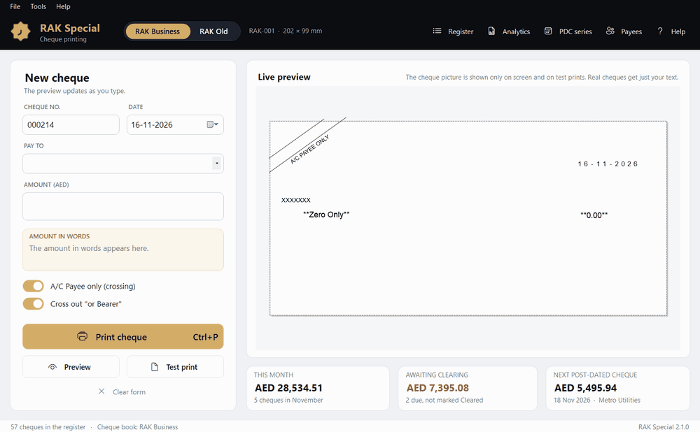
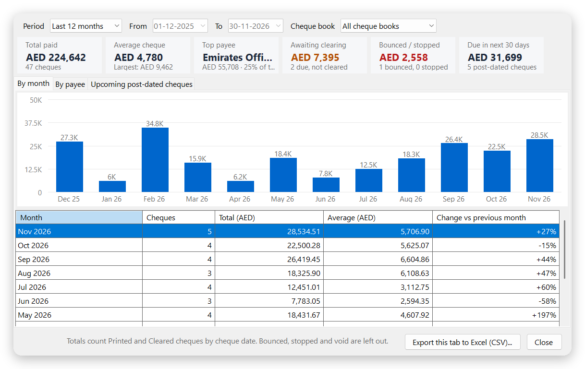
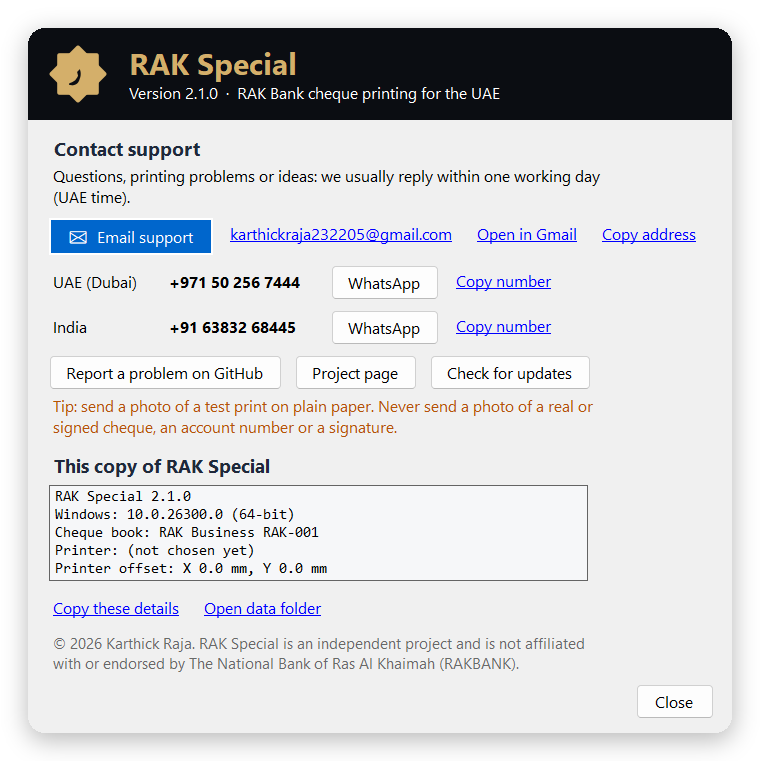
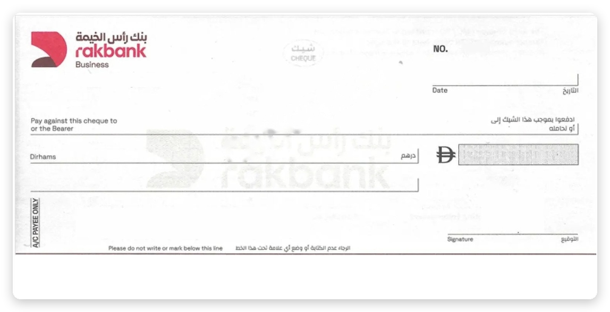
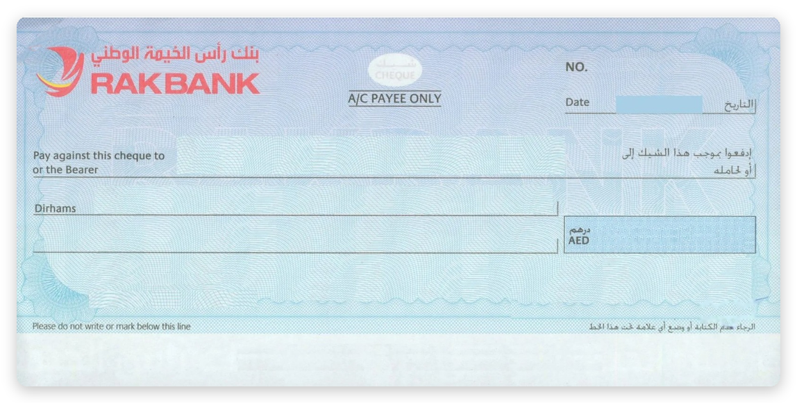

<div align="center">

<a href="https://github.com/KarthickRaja46/RakSpecial/releases/latest/download/RAKSpecial-Setup.exe">
  
</a>

# RAK Special: RAK Bank Cheque Printing Software for Windows

**Free cheque printing software for UAE businesses. Print RAKBANK cheques on any office printer,**<br>
**with the amount in words in AED and fils, post-dated cheque series, a cheque register and live analytics.**

<sub>برنامج مجاني لطباعة شيكات بنك رأس الخيمة الوطني (RAKBANK) على ويندوز · كتابة المبلغ بالكلمات بالدرهم والفلس · طباعة الشيكات المؤجلة</sub>

<br>

<a href="https://github.com/KarthickRaja46/RakSpecial/releases/latest/download/RAKSpecial-Setup.exe"></a>
<a href="https://github.com/KarthickRaja46/RakSpecial/releases/latest/download/RAKSpecial-Portable.zip"></a>

<sub>⚡ Direct download, always the latest version &nbsp;·&nbsp; <a href="https://github.com/KarthickRaja46/RakSpecial/releases">All releases and release notes</a> &nbsp;·&nbsp; 64-bit Windows 10 / 11</sub>

<br><br>

[](https://github.com/KarthickRaja46/RakSpecial/releases/latest)
[](https://github.com/KarthickRaja46/RakSpecial/releases)
[](https://github.com/KarthickRaja46/RakSpecial/actions/workflows/build.yml)


**[Features](#-features)** &nbsp;✦&nbsp; **[Screenshots](#-screenshots)** &nbsp;✦&nbsp; **[Install](#-installation)** &nbsp;✦&nbsp; **[Quick start](#-quick-start)** &nbsp;✦&nbsp; **[FAQ](#-frequently-asked-questions)** &nbsp;✦&nbsp; **[Support](#-support)**


### ⚡ See it in action



<sub>Real recording: type the payee and amount, and the words and the cheque preview follow live. Switch cheque books with one click.</sub>

<br><br>



</div>


## 💡 Why RAK Special

UAE businesses write cheques every week for rent, suppliers, salaries and instalments. Writing them by hand is slow,
and a spelling mistake in the amount in words can get a cheque rejected. **RAK Special types every cheque the same
way**: correctly spelled, aligned to the real RAK Bank leaf, and recorded in a register you can search, analyse and export.

## ✨ Features

<table>
  <tr>
    <td width="33%" valign="top">
      <h3>🖨️ Precise printing</h3>
      Both RAK Bank cheque books, with layouts measured from real leaves. A/C Payee crossing, "or Bearer" strike-through,
      a confirm box before every print and a duplicate-number warning.
    </td>
    <td width="33%" valign="top">
      <h3>🔤 Amount in words</h3>
      <code>4523.20</code> prints as <i>Four Thousand Five Hundred Twenty Three And Fils Twenty Only</i>. Long amounts wrap onto
      the second line, and you are warned if they do not fit.
    </td>
    <td width="33%" valign="top">
      <h3>📅 PDC series</h3>
      Print 12 monthly rent cheques in one go. Month ends stay correct (31 Jan → 28 Feb → 31 Mar), and UAE weekend dates
      can move to Monday or the Friday before.
    </td>
  </tr>
  <tr>
    <td width="33%" valign="top">
      <h3>📊 Live analytics</h3>
      Total paid by month and by payee, cheques awaiting clearing, bounced cheques, and the post-dated cheques coming up,
      with charts. Every table exports to Excel.
    </td>
    <td width="33%" valign="top">
      <h3>🗂️ Register &amp; status</h3>
      Every printed cheque is recorded. Mark cheques <b>Cleared</b>, <b>Bounced</b>, <b>Stopped</b> or <b>Void</b>, several at once,
      straight from your bank statement.
    </td>
    <td width="33%" valign="top">
      <h3>🎯 Layout editor</h3>
      Drag any field, move it 0.1 mm at a time, change font size or bold, set a printer offset, or use your own scan of a
      blank cheque.
    </td>
  </tr>
  <tr>
    <td width="33%" valign="top">
      <h3>🔒 Private &amp; offline</h3>
      Your cheques, payees and amounts never leave your PC. Automatic <code>.bak</code> copy on every save, plus one-click
      backup and restore.
    </td>
    <td width="33%" valign="top">
      <h3>🚀 Easy setup</h3>
      A normal Windows setup wizard with Start-menu and Desktop shortcuts and an uninstaller. No administrator rights,
      and no .NET to install.
    </td>
    <td width="33%" valign="top">
      <h3>💬 Built-in support</h3>
      Email or WhatsApp us from <i>Help</i> (F1), with your version and settings already filled in. New versions install
      with one click.
    </td>
  </tr>
</table>

<details>
<summary><b>See the full feature list</b></summary>

### Cheque printing
- **Both RAK Bank cheque books** (RAK Business and RAK Old), with layouts measured from real leaves.
- **Amount in words with fils**, wrapped onto the second line automatically, with a warning if it does not fit.
- **A/C Payee crossing** and **"or Bearer" strike-through**, each on or off per cheque.
- **Live preview** while you type, and **plain-paper test prints** to check alignment before using a real leaf.
- **Confirm before every print** (date, payee, amount and words) and a **duplicate cheque number** warning.

### Post-dated cheques (PDC)
- Enter the payee, amount, first cheque number and first date once, then print the whole series.
- Correct month ends, and optional moving of UAE weekend dates.

### Cheque register and status
- Search, date filter, notes, reprint, and **export to Excel (CSV)**.
- Status **Printed, Cleared, Bounced, Stopped or Void**; a reason is saved for bounced and stopped cheques.

### Analytics
- **Summary cards**: total paid, average and largest cheque, top payee, awaiting clearing, bounced or stopped, due in the next 30 days.
- **By month**: chart and table with the change from the previous month; post-dated months shown lighter.
- **By payee**: cheques, total, share, average, largest and bounces, with a monthly chart per payee.
- **Upcoming post-dated cheques**: due in the next 30, 90 or 365 days.
- Filter by period and cheque book. Every table exports to Excel.

### Everyday use
- Modern workspace: form on the left, live preview on the right, this month's figures always in view.
- **Payee list** with auto-complete; new payees are saved automatically.
- **Help & support** window (F1): email, WhatsApp, problem reports.
- **Automatic updates**: when a new version is out, an *Update available* window opens at start. **Update now**
  downloads it, installs it and reopens RAK Special by itself (can be turned off in *Tools → Settings*).

</details>


## 📸 Screenshots

<p align="center">
  
  <br><sub><b>Main window</b>: the cheque form, live preview, and this month's figures</sub>
</p>

<table>
  <tr>
    <td width="50%" valign="top">
      
      <p align="center"><b>Analytics by month</b><br><sub>Total paid, awaiting clearing, bounced cheques and a monthly chart</sub></p>
    </td>
    <td width="50%" valign="top">
      
      <p align="center"><b>Analytics by payee</b><br><sub>What each payee received, with a monthly chart</sub></p>
    </td>
  </tr>
  <tr>
    <td width="50%" valign="top">
      
      <p align="center"><b>Upcoming post-dated cheques</b><br><sub>Know how much must be in the account, and by when</sub></p>
    </td>
    <td width="50%" valign="top">
      
      <p align="center"><b>Help &amp; support</b><br><sub>Email, WhatsApp and problem reports, built in</sub></p>
    </td>
  </tr>
</table>

<sub>Screenshots use sample data.</sub>


## 🏦 Supported cheque books

<table>
  <tr>
    <td width="50%" valign="top">
      
      <p align="center"><b>RAK Business</b> · RAK-001 · 202 × 99 mm<br><sub>Amount box level with the <b>first</b> words line</sub></p>
    </td>
    <td width="50%" valign="top">
      
      <p align="center"><b>RAK Old</b> · RAK-002 · 206 × 100 mm<br><sub>Amount box lower, level with the <b>second</b> words line</sub></p>
    </td>
  </tr>
</table>

| Cheque book | Code | Leaf size | How to tell them apart |
|---|---|---|---|
| RAK Business (new model) | RAK-001 | 202 × 99 mm | Amount box level with the **first** words line |
| RAK Old (wider book) | RAK-002 | 206 × 100 mm | Amount box lower, level with the **second** words line |

Choose the book in your hand: the wrong choice prints the figures in the wrong place. The RAK Business picture is
measured against a real printed cheque (landmarks within 0.2 mm on average).
Other banks can be set up with the layout editor; built-in layouts are on the [roadmap](#-roadmap).

## 💻 System requirements

| | |
|---|---|
| Operating system | Windows 10 or Windows 11, 64-bit |
| Printer | Any Windows printer that takes A4 paper (laser recommended) |
| Disk space | About 80 MB |
| Other software | None. .NET is built in. |
| Permissions | Normal user. No administrator rights needed. |
| Internet | Not needed. Used only for the optional update check and the support links. |

## 📦 Installation

1. **[Download RAKSpecial-Setup.exe](https://github.com/KarthickRaja46/RakSpecial/releases/latest/download/RAKSpecial-Setup.exe)** (always the latest version).
2. Double-click it and follow the wizard: **Next → Install → Finish**.
   It adds *RAK Special* to the Start menu, and to the Desktop if you leave that box ticked.
3. The last page shows the first steps, then RAK Special opens.

> [!TIP]
> **"Windows protected your PC"?** Click **More info → Run anyway**. Windows shows this for new programs that are
> not code-signed yet. Download the setup only from this repository.

| | |
|---|---|
| 🔄 **Update** | Automatic. When a new version is out, RAK Special shows an **Update available** window when it starts: click **Update now**. It downloads, installs and reopens by itself, and your data is kept. You can also use *Help → Check for updates*. |
| 🗑️ **Uninstall** | *Windows Settings → Apps → Installed apps → RAK Special → Uninstall*. Your data is kept. |
| 💾 **No install allowed?** | [Download the portable ZIP](https://github.com/KarthickRaja46/RakSpecial/releases/latest/download/RAKSpecial-Portable.zip), extract it and double-click `RAKSpecial.exe`. Data stays in a `Data` folder beside it, so it runs from a USB stick too. |

## 🚀 Quick start

1. **Choose your cheque book** in the header: **RAK Business** or **RAK Old**.
2. **Test on plain paper**: click **Test print** and hold the sheet against a real cheque in front of a light.
   - Everything shifted the same way → *Tools → Layout editor → Cheque & printer settings → Offset X / Offset Y*.
   - Only one field is off → drag that field in the layout editor.
3. **Print**: fill in the cheque number, date, payee and amount. Put the cheque in the top-left corner of an
   A4 landscape page against the paper guide, and press **Print cheque** (Ctrl+P).
4. **Keep the register up to date**: in **Register**, mark cheques **Cleared** as they appear on your bank statement.
   Analytics then shows what is still awaiting clearing.

| Shortcut | Action |
|---|---|
| <kbd>Ctrl</kbd> + <kbd>P</kbd> | Print cheque |
| <kbd>Ctrl</kbd> + <kbd>T</kbd> | Analytics |
| <kbd>F1</kbd> | Help & support |

## 🔒 Your data, privacy and backups

- All data stays **on your computer** in one file: `%APPDATA%\RAK Special\rakspecial-data.json`
  (layouts, payees, cheque register and settings). The portable version keeps it in a `Data` folder beside the program.
- Every save keeps the previous version as a `.bak` file. Use **File → Backup data** regularly, and
  **File → Restore data from backup** to move to a new PC.
- RAK Special never sends your cheques, payees or amounts anywhere. The only network request is the update check,
  which reads the latest version number from GitHub. Turn it off in *Tools → Settings → Check for updates*.


## 🛠️ Troubleshooting

<details>
<summary><b>The text is not on the lines of the cheque</b></summary>

Make a test print on plain paper and hold it against a real cheque. If everything is shifted the same way, change
Offset X (right +, left −) and Offset Y (down +, up −) in *Tools → Layout editor → Cheque & printer settings*. If one
field is off, drag it. Always feed the cheque the same way, against the paper guide.
</details>

<details>
<summary><b>"Amount in words does not fit on the cheque lines"</b></summary>

Very long amounts may not fit the two words lines. Reduce the words font size in the layout editor, or shorten the
wording in *Tools → Settings*.
</details>

<details>
<summary><b>The Desktop icon still shows the old logo after an update</b></summary>

Windows caches icons. Sign out and back in, or restart the PC. Setup 2.1.0 and later ask Windows to refresh icons
automatically.
</details>

<details>
<summary><b>Moving RAK Special to a new computer</b></summary>

On the old PC: *File → Backup data*. Install RAK Special on the new PC, then *File → Restore data from backup*.
</details>

## ❓ Frequently asked questions

<details>
<summary><b>What is RAK Special?</b></summary>

A Windows program that prints RAK Bank (RAKBANK) cheques on an ordinary office printer. You type the payee and amount;
it prints the date, payee, amount in figures and the amount in words in the right places on the cheque.
</details>

<details>
<summary><b>Is RAK Special free?</b></summary>

Yes. There is no subscription, licence fee or account to create.
</details>

<details>
<summary><b>Which RAK Bank cheque books does it support?</b></summary>

The RAK Business cheque (RAK-001, 202 × 99 mm) and the older, wider RAK cheque book (RAK-002, 206 × 100 mm).
</details>

<details>
<summary><b>Does it write the amount in words in AED with fils?</b></summary>

Yes. For example, `4523.20` prints as *Four Thousand Five Hundred Twenty Three And Fils Twenty Only*. The wording can be
changed in *Tools → Settings*. Arabic amount in words is on the [roadmap](#-roadmap).
</details>

<details>
<summary><b>Can I print post-dated cheques (PDC) for rent or instalments?</b></summary>

Yes. *Tools → PDC series* prints a whole series, e.g. 12 monthly rent cheques, with the cheque numbers and dates filled in.
</details>

<details>
<summary><b>Which printers work?</b></summary>

Any Windows printer that takes A4 paper. Laser printers give the cleanest result. Use *Test print* on plain paper and the
printer offset to line it up once.
</details>

<details>
<summary><b>Does it need the internet? Is my data safe?</b></summary>

No internet is needed. Your cheques, payees and amounts stay on your PC and are never uploaded. Only the optional update
check contacts GitHub, and it fetches nothing but the latest version number.
</details>

<details>
<summary><b>Can I use it for Emirates NBD, ADCB, FAB or other UAE banks?</b></summary>

The layout editor can be set up for any cheque, and built-in layouts for more UAE banks are on the [roadmap](#-roadmap).
[Request your bank](https://github.com/KarthickRaja46/RakSpecial/issues/new/choose).
</details>

<details>
<summary><b>Does it work on Windows 7 or on a Mac?</b></summary>

No. It needs 64-bit Windows 10 or Windows 11.
</details>


## 💬 Support

<div align="center">

Need help with installation, printing or alignment? Talk to us directly.

<a href="mailto:karthickraja232205@gmail.com?subject=RAK%20Special%20support"></a>
<br>
<a href="https://wa.me/971502567444"></a>
<a href="https://wa.me/916383268445"></a>
<br>
<a href="https://github.com/KarthickRaja46/RakSpecial/issues/new/choose"></a>

| | |
|---|---|
| ✉️ **Email** | [karthickraja232205@gmail.com](mailto:karthickraja232205@gmail.com?subject=RAK%20Special%20support) |
| 🇦🇪 **UAE (Dubai)**, phone & WhatsApp | [+971 50 256 7444](https://wa.me/971502567444) |
| 🇮🇳 **India**, phone & WhatsApp | [+91 63832 68445](https://wa.me/916383268445) |

Inside the program, **Help → Help & support (F1)** opens email or WhatsApp with your version and settings already filled in.

</div>

> [!IMPORTANT]
> For your security, **never send a photo of a real or signed cheque, an account number or a signature.**
> A photo of a test print on plain paper is all we need.


## 🧑‍💻 Building from source

<details>
<summary><b>Build, test and release instructions</b></summary>

Requirements: Windows, the [.NET 8 SDK](https://dotnet.microsoft.com/download/dotnet/8.0) and, for the setup wizard,
[Inno Setup 6](https://jrsoftware.org/isinfo.php).

```bat
winget install Microsoft.DotNet.SDK.8
winget install JRSoftware.InnoSetup

git clone https://github.com/KarthickRaja46/RakSpecial.git
cd RakSpecial
dotnet test                              :: unit tests
dotnet run --project src\ChequeWriter    :: start the app
publish.bat                              :: release build: setup wizard + portable ZIP in Share\
```

The version number comes from `<Version>` in `src/ChequeWriter/ChequeWriter.csproj`. Pushing a tag such as `v2.1.0`
makes GitHub Actions run the tests, build the setup and the portable ZIP, and publish them as a release.

| Folder | Contents |
|---|---|
| `src/ChequeWriter.Core` | Cheque books, amount in words, PDC schedule, analytics, update check, JSON storage, CSV export (no UI) |
| `src/ChequeWriter` | Windows app: main window, printing, PDC series, layout editor, register, analytics, help & support |
| `installer` | Setup wizard (`RAKSpecial.iss`), its pictures, the first-steps page and the portable READ ME |
| `tests/ChequeWriter.Tests` | xUnit tests |
| `tools/make_images.py` | Rebuilds `docs/icon.png` and the setup pictures from `src/ChequeWriter/app.ico` |
| `tools/make_readme_art.py` | Rebuilds the animated README artwork in `docs/readme/` |

Project links and support contacts are set in one place: `src/ChequeWriter/AppInfo.cs`.

The cheque pictures shown in the preview and on test prints are built in from `src/ChequeWriter/Images/rak-business.jpg`
and `rak-old.jpg` (clean pictures at exact cheque size, 200 dpi). Users can still pick their own scan in the layout editor.

</details>

## 🤝 Contributing

Bug reports, cheque layouts for other banks and pull requests are welcome. Please read
[CONTRIBUTING.md](CONTRIBUTING.md) first. RAK Special prints real cheques, so every change needs tests and a
plain-paper check.

## 🧭 Roadmap

- [ ] Cheque book tracking: the leaf range of each book, with a low-stock warning
- [ ] Batch printing from Excel (salaries, supplier payments)
- [ ] Payment voucher / receipt slip printed with each cheque
- [ ] Scheduled automatic backups (e.g. to OneDrive)
- [ ] Arabic amount in words
- [ ] Layouts for more UAE banks (Emirates NBD, ADCB, FAB, Mashreq and others)
- [ ] Approval step before printing (one person enters, another approves)

Have an idea? [Open a feature request](https://github.com/KarthickRaja46/RakSpecial/issues/new/choose) or message us on WhatsApp.


## 🏷️ About

RAK Special is developed and maintained by **Karthick Raja**. © 2026 Karthick Raja.

RAK Special is an independent project. It is **not affiliated with, endorsed by or sponsored by The National Bank
of Ras Al Khaimah (RAKBANK)**. RAKBANK and RAK Bank are names of their respective owner and are used only to describe
which cheques this software prints. Always check a printed cheque before signing it.

<div align="center">

<a href="https://github.com/KarthickRaja46/RakSpecial/releases/latest/download/RAKSpecial-Setup.exe"></a>

<sub>If RAK Special saves you time, please ⭐ star the repository. It helps other UAE businesses find it.</sub>

</div>

## 🔎 Search terms

RAK Bank cheque printing software · RAKBANK cheque printer · RAK Bank cheque writer · cheque printing software UAE ·
cheque printing software Dubai, Abu Dhabi, Sharjah, Ajman, Ras Al Khaimah · cheque writer for Windows ·
amount in words AED with fils · dirham amount in words · PDC printing · post-dated cheque printing · rent cheque printing ·
cheque register software · free cheque printing software · business cheque printing UAE

برنامج طباعة الشيكات · طباعة شيكات بنك رأس الخيمة · برنامج كتابة الشيكات الإمارات · طباعة الشيكات المؤجلة ·
كتابة المبلغ بالكلمات بالدرهم
